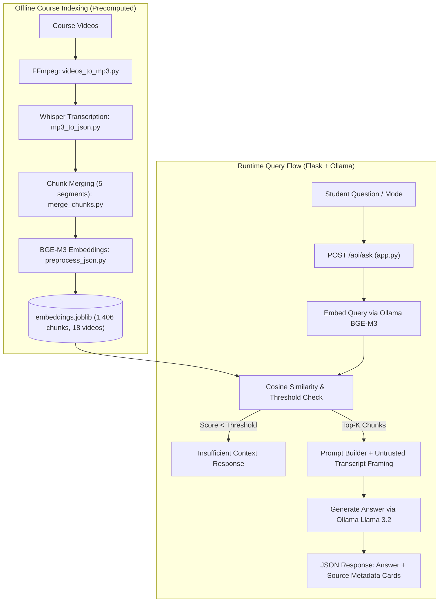

# RAG-Based AI Teaching Assistant (LearnAI)

An AI-powered personalized teaching assistant built for the **FLARE Open Innovation Rapid Hackathon**. It transforms long educational video courses into an interactive, searchable learning companion using **Retrieval-Augmented Generation (RAG)** — delivering grounded answers, exact video numbers and timestamps, multiple explanation styles, session chat history, and AI-generated quizzes.

Currently indexed on **18 videos (1,406 transcript chunks)** from the **Sigma Web Development Course**.

---

## Problem Statement

Students learning from long-form video courses face three major obstacles:
1. **Slow topic discovery:** Searching across hours of video lectures to find where a specific concept (like *CSS Box Model* or *Semantic HTML Tags*) is taught is tedious.
2. **Unreliable generic chatbots:** Generic AI chatbots answer from general training data without knowing what the instructor actually covered, in which lesson, or at what timestamp.
3. **Passive consumption:** Watching videos without targeted revision tools or practice checks makes it hard to verify understanding.

---

## Proposed Solution & Key Features

**LearnAI** solves this by indexing timestamped course transcripts with local semantic embeddings (**BGE-M3**) and pairing cosine-similarity retrieval with local LLM generation (**Llama 3.2**) inside a responsive Flask web application:

- **Grounded Course Q&A:** Answers questions strictly from retrieved course transcript chunks, citing the video number, video title, and start/end timestamps (`MM:SS`).
- **Visible Source Reference Cards:** Displays exact retrieved transcript metadata (`Video`, `Timestamp`, `Similarity %`, and `Excerpt`) separately below every AI answer — extracted directly from stored metadata, never guessed by the LLM.
- **Honest Out-of-Scope Guardrails:** Uses a configurable cosine-similarity relevance threshold (`RELEVANCE_THRESHOLD`) so unrelated or off-course questions do not trigger fabricated course citations.
- **Multiple Explanation Styles ("Simplify My Concept"):** Switch between **Standard**, **Beginner (ELI5)**, **Step-by-step**, **Summary**, and **Practical Example** modes on any course query.
- **AI Quiz Generator:** Generates grounded multiple-choice questions on any course topic, keeps correct answers server-side until submission, scores responses, and provides explanations.
- **Session Learning History:** Preserves recent conversation context for follow-up questions with a clear/reset option.
- **Privacy-First Local AI:** Embeddings and LLM inference run locally via Ollama without external API costs.

---

## Tech Stack & Architecture

| Layer | Technology | Purpose |
|---|---|---|
| **Web Backend** | Python, Flask, `python-dotenv` | Routing, REST APIs, session history, config loading |
| **Frontend** | HTML5, CSS3, Vanilla JS, Bootstrap 5 (CDN), Jinja2 | Responsive landing page & learning dashboard |
| **Embeddings** | Ollama (`bge-m3`, 1024-dim) | Semantic vector generation for chunks and queries |
| **Retrieval** | NumPy, Pandas, Scikit-learn (`cosine_similarity`), Joblib | Precomputed vector loading & top-k similarity ranking |
| **LLM Generation** | Ollama (`llama3.2`) | Grounded explanations & MCQ quiz generation |
| **Offline Preprocessing** | FFmpeg, OpenAI Whisper (`large-v2`) | Audio extraction & timestamped transcription (already precomputed) |
| **Testing** | Pytest | Unit & Flask integration tests |

---

## RAG Workflow



---

## Project Structure

```text
.
├── app.py                   # Flask app entry point, dotenv startup, template & API routes
├── config.py                # Centralized environment-based configuration
├── rag/
│   ├── __init__.py
│   ├── retrieval.py         # Query embedding, cosine similarity ranking, source formatting
│   ├── generation.py        # Prompt construction, untrusted data framing, Ollama LLM calls
│   └── pipeline.py          # Startup embedding loader, Q&A orchestration, Ollama health probe
├── services/
│   ├── __init__.py
│   └── quiz_service.py      # RAG-backed MCQ generation, JSON validation, server-side scoring
├── templates/
│   ├── base.html            # Base HTML layout + Bootstrap 5
│   ├── index.html           # Landing / welcome page
│   └── dashboard.html       # Interactive dashboard (Chat, Quiz, History, About)
├── static/
│   ├── css/style.css        # Responsive dark-theme EdTech styles
│   └── js/app.js            # Frontend chat, explanation modes, quiz, and history logic
├── tests/
│   └── test_rag.py          # Unit and Flask endpoint tests
├── videos_to_mp3.py         # Offline pipeline step 1: extract MP3 audio via FFmpeg
├── mp3_to_json.py           # Offline pipeline step 2: Whisper transcription to jsons/
├── merge_chunks.py          # Offline pipeline step 3: merge transcript chunks to newjsons/
├── preprocess_json.py       # Offline pipeline step 4: build embeddings.joblib via BGE-M3
├── process_incoming.py      # Original CLI RAG script (preserved)
├── jsons/                   # Raw timestamped transcripts (18 JSON files)
├── newjsons/                # Merged transcript chunks (18 JSON files)
├── embeddings.joblib        # Precomputed BGE-M3 embeddings DataFrame (1,406 chunks)
├── requirements.txt         # Python dependencies
├── .env.example             # Environment variable template
├── DEPLOYMENT.md            # Detailed Ngrok & deployment troubleshooting guide
└── DEMO_SCRIPT.md           # 3-minute FLARE hackathon demo script & judge Q&A
```

---

## Installation & Setup

### Prerequisites
- **Python 3.10+** (tested on Python 3.13.9)
- **Ollama** installed locally (<https://ollama.com/download>)
- Precomputed `embeddings.joblib` (already included in the repository)

### 1. Clone and Install Python Dependencies
```bash
git clone https://github.com/VanshPuri15/RAG-Based-AI-Teaching-Assistant.git
cd RAG-Based-AI-Teaching-Assistant
pip install -r requirements.txt
```

### 2. Ollama Model Setup
Pull the required embedding and generation models:
```bash
ollama pull bge-m3
ollama pull llama3.2
```
Ensure Ollama is running locally (default port `11434`):
```bash
ollama serve
```
*(If the Ollama desktop app is already running on Windows/macOS, `ollama serve` is handled automatically.)*

### 3. Environment Variable Configuration
Copy `.env.example` to `.env` and customize as needed (`app.py` automatically loads `.env` via `python-dotenv` at startup):

- **Windows PowerShell:**
  ```powershell
  Copy-Item .env.example .env
  ```
- **macOS / Linux:**
  ```bash
  cp .env.example .env
  ```

| Variable | Default | Description |
|---|---|---|
| `OLLAMA_BASE_URL` | `http://localhost:11434` | Local Ollama server URL |
| `EMBED_MODEL` | `bge-m3` | Ollama embedding model name |
| `LLM_MODEL` | `llama3.2` | Ollama chat/generation model name |
| `OLLAMA_TIMEOUT` | `60` | HTTP request timeout (seconds) for Ollama |
| `TOP_K` | `5` | Number of transcript chunks retrieved per query |
| `RELEVANCE_THRESHOLD` | `0.55` | Minimum cosine similarity required to treat chunks as relevant |
| `SECRET_KEY` | `change-me-in-production` | Flask session secret (replace with a strong random hex value) |
| `FLASK_DEBUG` | `false` | Set `true` only for local development debugging |
| `HOST` | `127.0.0.1` | Bind host (`127.0.0.1` keeps Flask local for Ngrok) |
| `PORT` | `5000` | Flask HTTP port |
| `COURSE_NAME` | `Sigma Web Development Course` | Displayed course title |
| `EMBEDDINGS_PATH` | `./embeddings.joblib` | Optional custom path to the embeddings file |

> **Security:** Never commit `.env` to Git or expose secrets. `.env` is ignored via `.gitignore`.

---

## Running Locally

Start the Flask server from the project root:
```bash
python app.py
```

Open your browser to:
- Landing Page: <http://127.0.0.1:5000/>
- Learning Dashboard: <http://127.0.0.1:5000/dashboard>
- Health Check: <http://127.0.0.1:5000/health>

You can also still use the original CLI script if desired:
```bash
python process_incoming.py
```

---

## Ngrok Public Demo Deployment

For a temporary public demo URL (e.g., sharing with hackathon judges):

1. Keep **Ollama** running locally on `localhost:11434`.
2. Keep **Flask** running locally (`python app.py`) on `127.0.0.1:5000`.
3. In a separate terminal, expose **only port `5000`** with Ngrok:
   ```bash
   ngrok http 5000
   ```
4. Share the generated `https://*.ngrok-free.app` URL.

> **Important Security & Operational Rules:**
> - **Expose ONLY port `5000` (Flask).** Never expose port `11434` (Ollama).
> - Your local computer, Ollama, Flask, and Ngrok must remain awake and running while anyone accesses the Ngrok URL.
> - See [`DEPLOYMENT.md`](DEPLOYMENT.md) for Ngrok setup, security checklist, and full troubleshooting.

---

## API Endpoints

| Method | Endpoint | Purpose | Request Body / Params |
|---|---|---|---|
| `GET` | `/` | Landing page | — |
| `GET` | `/dashboard` | Main learning dashboard UI | — |
| `GET` | `/health` | App, embeddings, and Ollama readiness status | — |
| `GET` | `/api/videos` | List all indexed course videos | — |
| `POST` | `/api/ask` | Ask a question with RAG retrieval | `{"query": "...", "mode": "default\|simple\|step_by_step\|summary\|example"}` |
| `GET` | `/api/history` | Get current session Q&A history | — |
| `POST` | `/api/history/clear` | Clear session Q&A history | — |
| `POST` | `/api/quiz/generate` | Generate a course-grounded MCQ quiz | `{"topic": "...", "num_questions": 5}` |
| `POST` | `/api/quiz/score` | Score submitted quiz answers | `{"quiz_id": "...", "answers": {"0": "A"}}` |

---

## Running Tests

Run the unit and Flask API test suite (uses synthetic fixtures / mocked Ollama so tests run quickly offline):
```bash
python -m pytest tests/ -v
```

---

## Known Limitations & Future Improvements

### Known Limitations
- **Local Ollama dependency:** By default, inference runs locally on Ollama; cloud hosting without a local GPU/VM tunnel requires configuring an external Ollama host or hosted API adapter.
- **No hosted video player URLs yet:** Source reference cards display exact video numbers, titles, and timestamps (`MM:SS`) from transcripts, as external YouTube/video URLs are not stored in `embeddings.joblib`.
- **In-memory quiz & cookie session state:** Active quiz answer keys are kept in an in-memory bounded store (`_QUIZ_STORE`), and chat history is stored in Flask client-side session cookies (capped at the last 5 Q&A exchanges).
- **Single-course dataset:** Currently indexed on the first 18 HTML & CSS lessons of the Sigma Web Development Course.

### Future Improvements
- Store canonical video URLs (e.g., YouTube watch links with `?t=<seconds>`) in chunk metadata for one-click timestamp playback.
- Add an upload/indexing UI so instructors can add new courses, PDFs, or slides directly from the dashboard.
- Add hybrid retrieval (BM25 keyword + BGE-M3 dense search) and cross-encoder re-ranking for sharper exact-term matches.
- Optional cloud LLM/embedding provider toggle for serverless hosting.
